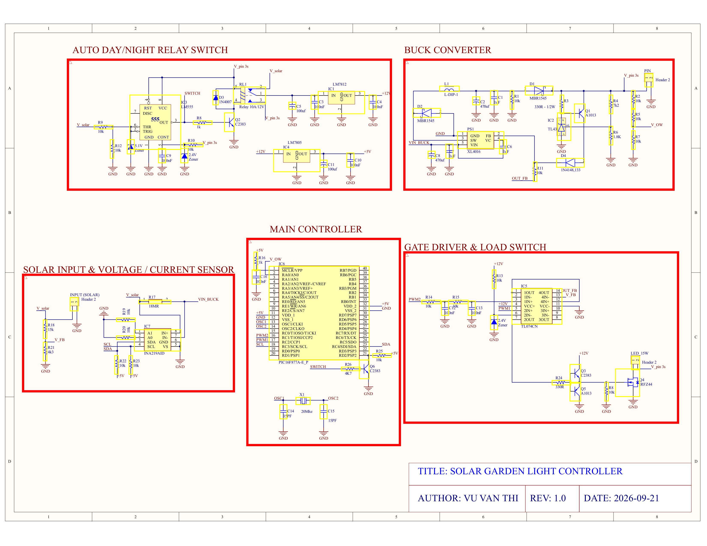
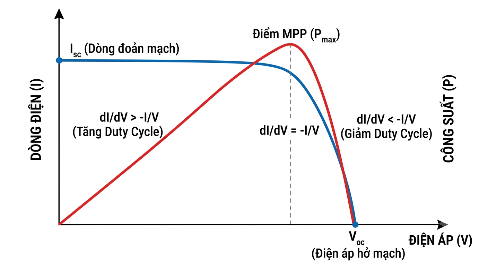
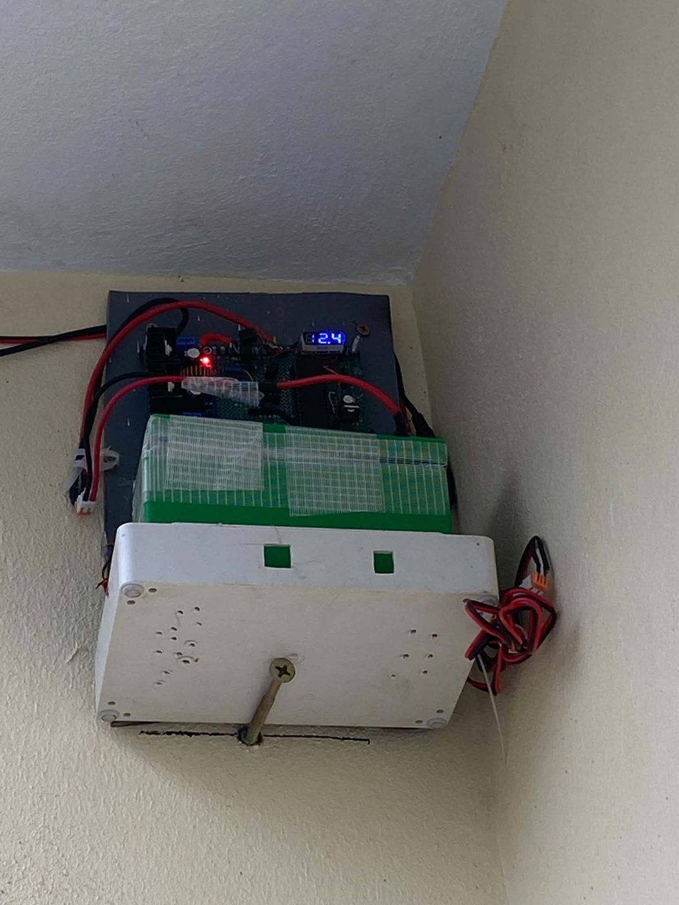
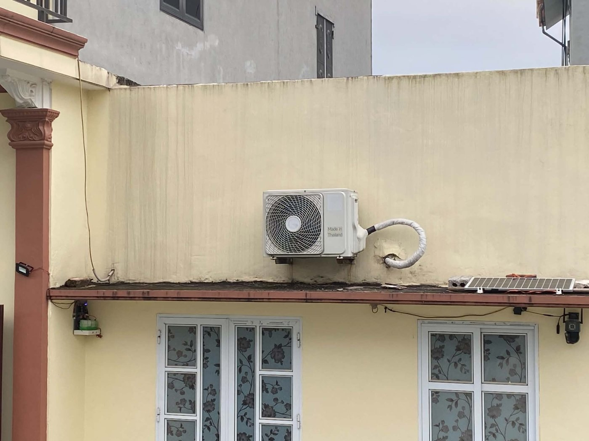
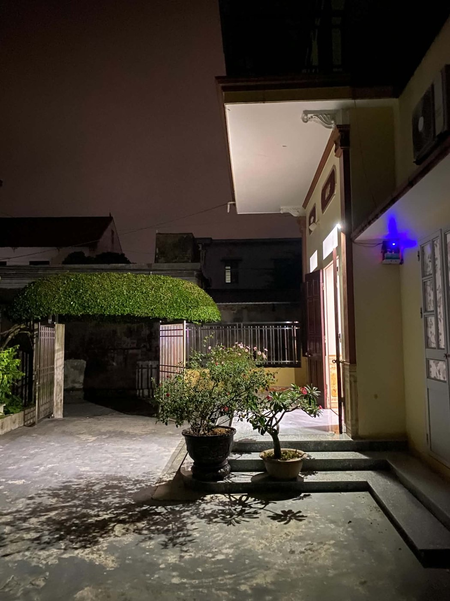

# Solar Garden Light Controller

Bộ điều khiển đèn vườn năng lượng mặt trời: ban ngày sạc pin bằng thuật toán **MPPT (Incremental Conductance)** để lấy tối đa công suất từ tấm pin, ban đêm tự động bật đèn LED 15 W và giảm dần độ sáng theo thời gian để tiết kiệm pin.

Tác giả: Vũ Văn Thi · Phiên bản phần cứng: Rev 1.0 (2026-09-21)



## Tính năng

- **MPPT Incremental Conductance** chạy trên PIC16F877A, đo dòng và áp tấm pin bằng INA219 (I2C). Vi điều khiển chỉ tạo **điện áp đặt** cho tấm pin, phần công suất do mạch buck XL4016 đảm nhiệm (xem mục *Cách điều khiển công suất*).
- **Bảo vệ sạc pin:** đọc điện áp pin qua ADC (RA0), ngắt sạc khi điện áp vượt ngưỡng hoặc dòng sạc giảm thấp, sạc lại khi điện áp tụt xuống.
- **Chiếu sáng ban đêm:** đèn LED 15 W điều chỉnh bằng PWM, sáng mạnh 4 giờ đầu rồi giảm 3 mức theo thời gian, tắt sau 12 giờ. Nếu pin yếu thì giảm một nửa độ sáng.
- **Tự nhận biết ngày/đêm** bằng mạch LM555 + rơ-le, tín hiệu `STATE` (RD2) báo cho vi điều khiển.
- **Lưu thời gian chiếu sáng vào EEPROM** mỗi 10 phút, khôi phục được khi bị reset giữa đêm (watchdog).
- **Telemetry qua UART** (dòng, áp, công suất) để giám sát trên máy tính.

## Cấu trúc thư mục

```
Solar-Garden-Light-Controller/
├── README.md
├── .gitignore
├── Firmware/                  Code PIC16F877A (MPLAB X + XC8)
│   ├── MPPT-control.c         Chương trình chính: MPPT, chiếu sáng, EEPROM, UART
│   ├── INA219.c / .h          Driver cảm biến dòng/áp INA219
│   ├── i2c.c / .h             I2C phần cứng (master)
│   ├── PWM.c / .h             PWM 2 kênh (CCP1, CCP2)
│   └── USART.c / .h           UART 9600 baud
├── Hardware/
│   ├── schematic.pdf          Sơ đồ nguyên lý (PDF)
│   └── schematic.jpg          Sơ đồ nguyên lý (ảnh)
└── docs/
    └── mppt_incremental_conductance.png   Đường cong I-V / P-V và nguyên lý INC
```

## Phần cứng

| Khối | Linh kiện chính |
|---|---|
| Vi điều khiển | PIC16F877A, thạch anh 20 MHz |
| Đo dòng / áp tấm pin | INA219 (I2C, địa chỉ 0x40) |
| Mạch buck sạc pin | Module buck XL4016 8 A (cải hoán chân FB), hồi tiếp qua TL074 + TL431, diode MBR1545 |
| Mạch công tắc ngày/đêm | LM555 + rơ-le 10A/12V |
| Nguồn phụ | LM7812, LM7805 |
| Tầng công suất đèn | TL074 (driver) + MOSFET RFZ44, LED 15 W |

Sơ đồ chia 5 khối: Auto day/night relay switch, Buck converter, Main controller, Solar input & voltage/current sensor, Gate driver & load switch. Chi tiết trong `Hardware/schematic.pdf`.

### Thông số hệ thống

| Hạng mục | Giá trị |
|---|---|
| Tấm pin mặt trời | 40 W, kích thước 35 x 70 cm |
| Mạch buck | Module buck XL4016 loại 8 A, cải hoán để điều khiển bằng chân FB |
| Bộ pin | Li-ion 18650, 2500 mAh/cell, đấu 3S4P (12 cell), tổng dung lượng 10 Ah (điện áp khoảng 10.6 - 12.5 V) |
| Tải | Đèn LED 15 W |

**Cải hoán mạch buck để giảm chi phí:** thay vì tự thiết kế mạch buck công suất, dự án dùng module buck XL4016 8 A có sẵn, bỏ vòng hồi tiếp gốc và nối chân **FB** của XL4016 vào mạch điều khiển analog (TL074) do PIC đặt điểm làm việc. Nhờ vậy có được MPPT mà không cần chế tạo tầng công suất mới và không phải dùng IC MPPT chuyên dụng đắt tiền.

### Chân kết nối chính (PIC16F877A)

| Chân | Chức năng |
|---|---|
| RA0 (AN0) | Đo điện áp pin (ADC 10 bit) |
| RC1 (CCP2) | PWM2: độ sáng đèn LED |
| RC2 (CCP1) | PWM1: tạo điện áp đặt cho buck (qua lọc RC) |
| RC3 / RC4 | I2C SCL / SDA (INA219) |
| RC6 / RC7 | UART TX / RX |
| RD2 | `STATE`: 1 = ban ngày, 0 = ban đêm |

## Cách điều khiển công suất (phần "cơ bắp")

Vi điều khiển **không** điều khiển trực tiếp chân công tắc của buck. Vòng điều khiển analog bên ngoài làm việc đó, PIC chỉ đặt điểm làm việc cho nó:

```
PIC (PWM1, CCP1) -> lọc thông thấp RC -> điện áp đặt (DC)
                                              |
                                              v
Tấm pin -> phân áp R18/R21 -> V_FB --> TL074 (so sánh/khuếch đại sai lệch)
                                              |
                                              v
                                   OUT_FB -> chân FB của XL4016 -> buck lấy nhiều/ít dòng từ tấm pin
```

1. **PWM -> điện áp đặt:** xung PWM1 qua mạch lọc thông thấp RC (R14/R15, C12/C13) thành một mức điện áp DC. Duty càng lớn thì mức DC càng cao.
2. **So sánh:** TL074 so mức điện áp này với điện áp tấm pin đã được phân áp (`V_FB`, qua cầu chia R18 15k / R21 4k3).
3. **Điều khiển XL4016:** đầu ra TL074 (`OUT_FB`) kéo vào chân **FB** của XL4016, qua đó buck tự điều chỉnh dòng lấy từ tấm pin cho đến khi điện áp tấm pin bám theo điện áp đặt.
4. **Vai trò của MPPT:** thuật toán chỉ việc dịch điện áp đặt (biến `vol_control`, 0-1023) lên hoặc xuống từng bước nhỏ để tìm điểm công suất cực đại. Vì vậy "tăng/giảm duty" bên dưới thực chất là tăng/giảm **điện áp làm việc của tấm pin**.

Nhờ vòng analog xử lý tức thời, vi điều khiển chạy chậm cũng không ảnh hưởng đến độ ổn định của buck.

## Nguyên lý hoạt động

### Ban ngày (STATE = 1): MPPT Incremental Conductance

Tại điểm công suất cực đại: `dI/dV = -I/V`.

| Điều kiện | Hành động |
|---|---|
| `dI/dV > -I/V` | Tăng điện áp đặt (`vol_control += STEP`) |
| `dI/dV < -I/V` | Giảm điện áp đặt (`vol_control -= STEP`) |
| `dI/dV = -I/V` | Giữ nguyên |

Khi `dV` gần 0 (nhỏ hơn `EPSILON_V`) thì chỉ xét dấu của `dI`. Các ngưỡng nằm ở đầu `MPPT-control.c`: `STEP = 2`, `EPSILON_V = 0.02 V`, `EPSILON_I = 0.005 A`, `EPSILON_INC = 0.01`.



Bảo vệ pin: khi điện áp pin lớn hơn 4.18 (giá trị ADC quy đổi), nếu dòng sạc ước tính xuống dưới 0.22 A hoặc điện áp vượt 4.23 thì bật cờ ngắt sạc và đẩy điện áp đặt lên cực đại (duty 1023), để buck ngừng lấy công suất từ tấm pin. Khi điện áp tụt dưới 4.14 thì sạc lại, đặt duty về 500 rồi MPPT tìm lại điểm làm việc.

### Ban đêm (STATE = 0): chiếu sáng theo thời gian

| Thời gian từ lúc trời tối | Duty PWM đèn (pin đủ) |
|---|---|
| 0 - 4 giờ | 800 |
| 4 - 8 giờ | 400 |
| 8 - 12 giờ | 200 |
| Sau 12 giờ | 0 (tắt) |

Lúc khởi động, nếu điện áp pin dưới 4.05 thì chia duty cho 2 để tiết kiệm. Timer1 đếm thời gian, mỗi 10 phút ghi số phút vào EEPROM (địa chỉ 0x00-0x01). Khi chuyển sang ban ngày, bộ đếm và EEPROM được đặt về 0.

## Giao thức UART (9600 baud, 8N1)

**Gửi lên PC (14 byte, lặp mỗi khoảng 50 ms):** `0xAA 0xBB` + 12 byte gồm 3 số `float` (little-endian): dòng (A), áp (V), công suất (W).

**Nhận từ PC (5 byte):** `0xCC 0xDD` + 3 byte (`value_DAC` uint16, `light_power` uint8). Khung đã được nhận và lưu trong `rx_data`, hiện chưa dùng để điều khiển.

## Cấu hình INA219

- Địa chỉ I2C `0x40`, tốc độ 100 kHz.
- Thanh ghi cấu hình `0x3557` (12 bit, trung bình 4 mẫu).
- Giá trị hiệu chuẩn `val_calib = 38692` (đổi nếu thay điện trở shunt).

## Build và nạp

1. Mở MPLAB X IDE, tạo project mới với chip **PIC16F877A**, compiler **XC8**.
2. Thêm toàn bộ file trong thư mục `Firmware/`.
3. Thạch anh 20 MHz (`_XTAL_FREQ = 20000000`), `FOSC = HS`.
4. Biên dịch và nạp bằng mạch nạp (PICkit, ...). LVP đang tắt.

Lưu ý: cấu hình `CP = ON` và `CPD = ON` bật bảo vệ chống đọc code. Muốn nạp lại hoặc đọc lại chip thì phải xóa hoàn toàn chip trước.

## Kết quả thử nghiệm

Mạch được lắp và chạy thực tế tại nhà, ngoài trời, liên tục nhiều ngày. Mạch được treo ở trên cao nên chưa kết nối UART để ghi lại dữ liệu dòng, áp, công suất. Các số liệu dưới đây là điện áp bộ pin quan sát trong quá trình sử dụng thực tế (đo bằng đồng hồ số trên mạch), không phải kết quả đo có kiểm soát.

| Điều kiện | Kết quả quan sát |
|---|---|
| Trời nắng thuận lợi | Sạc từ khoảng 10.6 V lên khoảng 12.4 V (xấp xỉ 90% dung lượng) trong khoảng 3.5 giờ |
| Trời không nắng (không mưa) | Vẫn sạc được, bộ pin tăng từ khoảng 11.5 V lên khoảng 12.5 V |

Ở điều kiện ánh sáng yếu, mạch vẫn sạc được nhờ MPPT liên tục dò điểm làm việc của tấm pin thay vì giữ điện áp cố định.

Ảnh chụp hệ thống đang hoạt động:

**Mạch điều khiển sau khi lắp** (đồng hồ số hiển thị điện áp pin 12.4 V):



**Vị trí lắp đặt:** mạch gắn dưới mái hiên, tấm pin mặt trời đặt trên mép tường.



**Chiếu sáng ban đêm:** đèn LED tự bật khi trời tối, chiếu sáng sân nhà.



Việc cần làm tiếp: ghi log qua UART (dòng, áp, công suất) trong một ngày nắng để có đồ thị I-V, P-V thực tế và đánh giá hiệu quả của MPPT.

## Hướng phát triển

- Dùng khung UART nhận từ PC để điều chỉnh độ sáng hoặc đặt ngưỡng từ xa.
- Thêm bảo vệ quá dòng, quá nhiệt.
- Tối ưu bước `STEP` theo công suất để hội tụ nhanh hơn.
